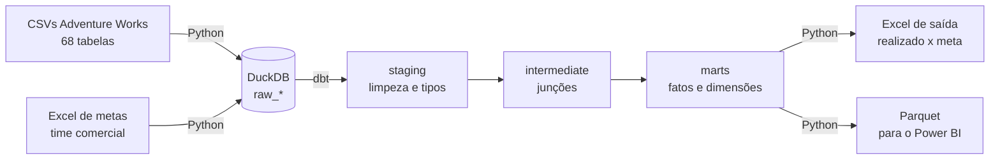

# Adventure Works: pipeline de dados com Python, dbt e Excel

Pipeline de dados de ponta a ponta sobre a base **Adventure Works** da Microsoft: os CSVs brutos do sistema transacional e uma planilha de metas do time comercial viram um modelo dimensional testado no dbt, e o resultado sai em uma planilha Excel pronta para análise.



## O que o projeto mostra

- **Ingestão em Python:** os CSVs da Microsoft não têm cabeçalho e usam dois formatos de delimitador. O loader lê as colunas e os delimitadores direto do script SQL oficial, trata texto livre com quebra de linha e carrega **68 tabelas e 759 mil linhas em segundos**.
- **Excel como fonte:** as metas mensais de venda vêm de uma planilha, como acontece de verdade nas empresas.
- **Modelagem com dbt em camadas:** `staging` (uma view por tabela, com tipos e nomes padronizados), `intermediate` (junções reaproveitáveis) e `marts` (modelo estrela).
- **Qualidade de dados:** 64 testes, entre eles unicidade, nulos, integridade referencial entre fatos e dimensões, valores aceitos e testes de negócio. Exemplos: a soma dos itens precisa bater com o subtotal do pedido, e todo território que vendeu precisa ter meta.
- **Excel como saída:** a planilha final tem realizado x meta com atingimento colorido, vendas por categoria e os maiores produtos e clientes.
- **Parquet para o Power BI:** os marts também saem em Parquet. O Power BI lê sem driver e sem travar o banco enquanto o pipeline roda.

## Modelo de dados (marts)

| Tabela | Grão | Conteúdo |
|---|---|---|
| `fct_sales` | item de pedido | quantidade, valor bruto, desconto, líquido, custo e margem (USD) |
| `fct_sales_vs_target_monthly` | território × mês | realizado, meta da planilha e atingimento |
| `dim_customer` | cliente | nome, tipo (pessoa física ou revenda), primeira e última compra |
| `dim_product` | produto | categoria, subcategoria, modelo, linha, preço e custo |
| `dim_territory` | território | país e grupo (América do Norte, Europa, Pacífico) |
| `dim_date` | dia | ano, trimestre, mês, dia da semana |

## Tecnologias

| Etapa | Ferramenta |
|---|---|
| Ingestão | Python 3, pandas |
| Armazenamento | DuckDB (banco em arquivo, sem servidor) |
| Transformação e testes | dbt-core + dbt-duckdb |
| Fonte e saída de negócio | Excel (openpyxl) |
| Consumo no BI | Parquet → Power BI |

## Como executar

```bash
python -m venv .venv
.venv\Scripts\activate          # Linux/Mac: source .venv/bin/activate
pip install -r requirements.txt
python run_pipeline.py
```

O `run_pipeline.py` baixa a base oficial (cerca de 17 MB), carrega no DuckDB, roda `dbt build` e gera `output/adventureworks_vendas.xlsx` e `output/parquet/`.

### Conectar no Power BI

1. **Obter dados** → **Pasta** → selecione `output/parquet`.
2. Em **Transformar dados**, combine ou carregue cada arquivo como uma tabela: `fct_sales`, `dim_customer`, `dim_product`, `dim_territory`, `dim_date` e `fct_sales_vs_target_monthly`.
3. Relacione `fct_sales` com as dimensões pelas chaves `customer_id`, `product_id`, `territory_id` e `order_date` → `date_day`, e marque `dim_date` como tabela de datas.

Para atualizar, rode `python run_pipeline.py` e clique em **Atualizar** no Power BI.

Para rodar só o dbt:

```bash
cd transform
dbt build --profiles-dir .
dbt docs generate --profiles-dir . && dbt docs serve --profiles-dir .
```

## Estrutura

```
├── ingestion/
│   ├── download_data.py          # baixa a base oficial da Microsoft
│   ├── load_raw.py               # CSVs -> DuckDB (raw_*)
│   ├── create_targets_excel.py   # gera a planilha de metas de exemplo
│   └── load_excel.py             # planilha de metas -> DuckDB (raw_excel)
├── data/
│   └── excel/metas_vendas.xlsx   # fonte de negócio (versionada)
├── transform/                    # projeto dbt
│   ├── models/staging/           # adventureworks/ e excel/
│   ├── models/intermediate/
│   ├── models/marts/
│   ├── tests/                    # testes de negócio
│   └── macros/
├── export/
│   ├── export_excel.py           # marts -> Excel formatado
│   └── export_parquet.py         # marts -> Parquet (Power BI)
└── run_pipeline.py               # orquestra tudo
```

## Fluxo de branches

| Branch | Uso |
|---|---|
| `main` | versão estável, só recebe merge via pull request |
| `develop` | integração do trabalho em andamento |
| `feature/<nome>` | cada nova funcionalidade, criada a partir de `develop` |
| `fix/<nome>` | correções |

Commits seguem o padrão [Conventional Commits](https://www.conventionalcommits.org/pt-br/), por exemplo `feat:`, `fix:`, `docs:` e `refactor:`.

## Observações

- A margem usa o **custo padrão atual** do produto, que é uma aproximação. A base não traz o custo histórico de cada venda.
- As metas são **fictícias**, geradas a partir da venda real com uma variação aleatória fixa, só para treino.
- Dados: [Adventure Works, Microsoft SQL Server Samples](https://github.com/microsoft/sql-server-samples/releases/tag/adventureworks) (licença MIT).

## Autor

**Caio Henrique**, Analista de BI e Dados · [LinkedIn](https://www.linkedin.com/in/caiohenriqu) · [GitHub](https://github.com/Caio-Henrique-Souza)
